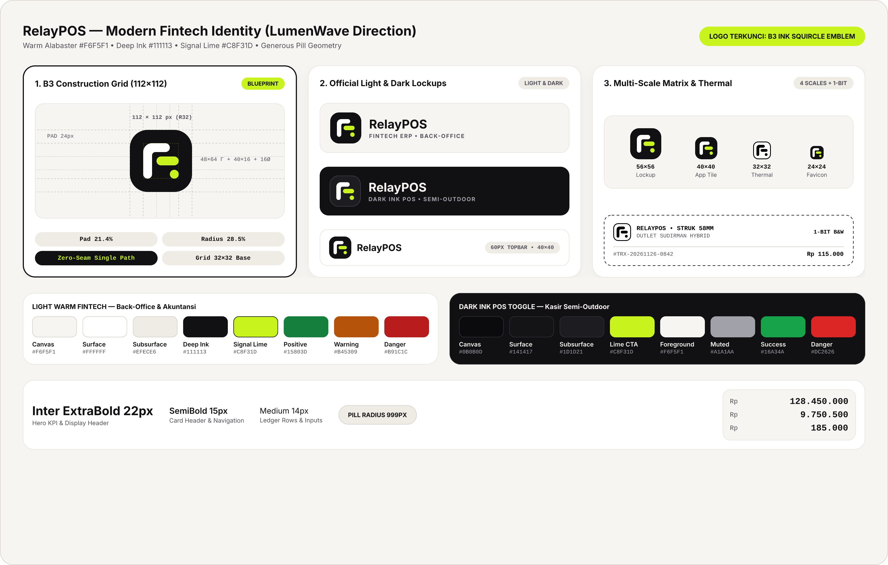
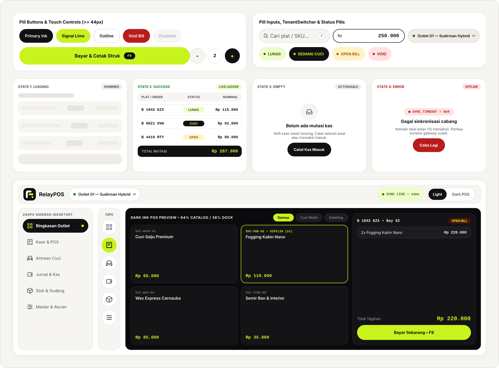
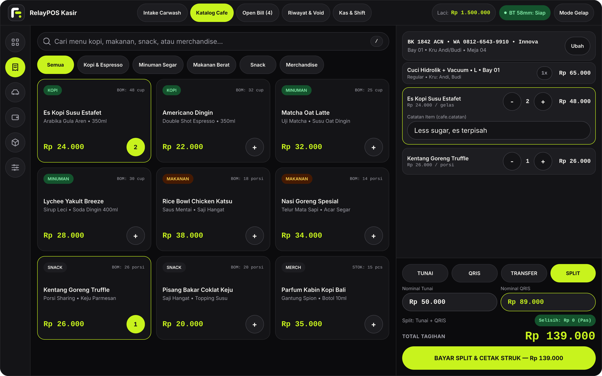
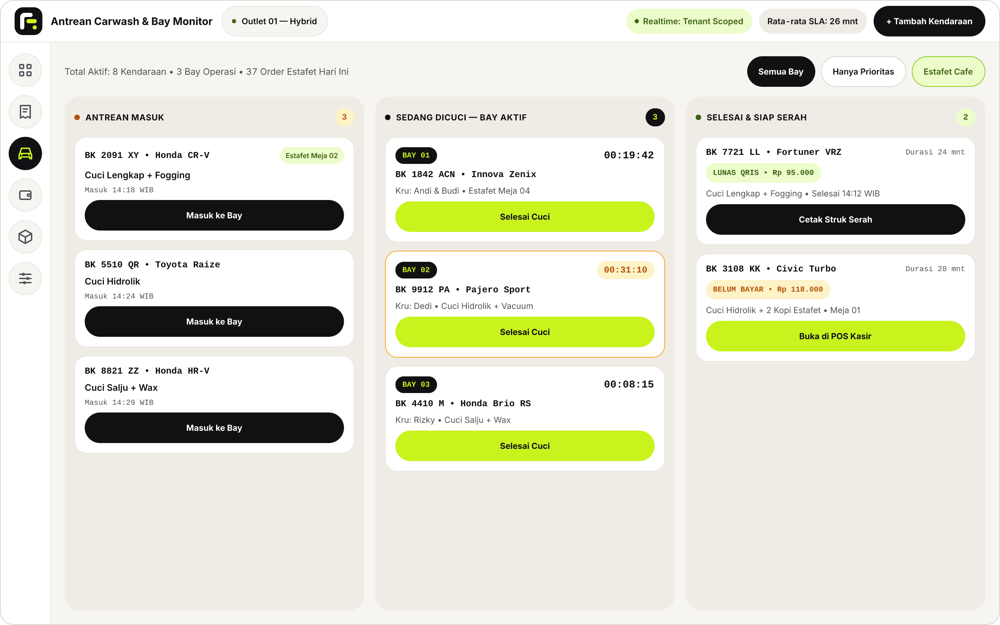

# RelayPOS — Modern Fintech UI/UX Design System (v4.2)

> **Status:** Approved (`@UIUX_Design_Auditor` — WCAG 2.2 AA, Anti-AI Slop, Database-Backed POS)
> **Referensi Gaya:** Modern Fintech (*LumenWave Direction* — Warm Alabaster `#F6F5F1`, Floating Cards, Deep Ink `#111113`, Signal Lime `#C8F31D`, Pill Geometry)
> **Branch:** `chore/uiux-rebrand-plan`

---

## Berkas Utama & Aset Desain

| Berkas | Deskripsi |
| :--- | :--- |
| [`RelayPOS-Rebrand.figcraft`](./RelayPOS-Rebrand.figcraft) | File sumber desain **FigCraft** lengkap (Page 1: Enterprise Navy & Page 2: **Modern Fintech v4.2**) |
| [`MASTER.md`](./MASTER.md) | Spesifikasi token 3-lapis, blueprint matematis Logo B3, ikon vektor, tipografi & 4 *UI States* |
| [`pages/pos.md`](./pages/pos.md) | Override spesifikasi khusus POS Kasir (`04A` & `04B`) dan Antrean Carwash (`05`) |
| [`assets/relaypos-logo-b3-light.svg`](./assets/relaypos-logo-b3-light.svg) | Logo SVG resmi **B3 Ink Squircle Emblem** (Light Header / App Tile) |
| [`assets/relaypos-logo-b3-dark.svg`](./assets/relaypos-logo-b3-dark.svg) | Logo SVG resmi **B3 Ink Squircle Emblem** (Dark POS / Login Panel) |

---

## Galeri Pratinjau Wave 1 (Page 2 — Modern Fintech v4.2)

### 00 — Brand Blueprint: Logo B3 & Dual-Mode Tokens


### 01 — Core UI Kit (Pill Controls, 4 UI States & App Shell)


### 02 — Login & Co-Owner SSO Access


### 03 — Executive Cockpit Dashboard (Light Mode Default)


### 04A — Hybrid POS: Intake Kendaraan (`carwash` + CRM) & Pelunasan Tunai (`struk`)


### 04B — Hybrid POS: Katalog Cafe & Merchandise, Catatan Item & `SPLIT` Payment


### 05 — Antrean Carwash & Live Kanban Bay Monitor


---

## Cara Membuka & Mengedit dari Perangkat Lain (Remote Access)

1. **Lihat langsung di GitHub:** Semua dokumentasi token, aset SVG, dan 7 pratinjau layar PNG 2x di atas langsung tampil di browser desktop maupun HP melalui halaman folder `design-system/` ini.
2. **Edit ulang di FigCraft Desktop:**
   ```bash
   git fetch origin
   git checkout chore/uiux-rebrand-plan
   git pull origin chore/uiux-rebrand-plan
   ```
   Lalu jalankan peluncur portabel Windows:
   ```cmd
   scripts\open-figcraft.cmd
   ```
   *(Skrip otomatis membuka `design-system\RelayPOS-Rebrand.figcraft` dengan port kontrol MCP `--control 7979` dan izin tulis folder repo).*
