# RelayPOS — Modern Fintech UI/UX Design System (v5.0)

> **Status:** Complete Wave 1 + Wave 2 + Wave 3 (`17/17 Frames` — Audited `APPROVED` by `@UIUX_Design_Auditor`)
> **Palet Disetujui (v5.0):**
> - **Light Mode (Back-Office, Dashboard, Kanban, Login, Landing, SOP):** Cool Alabaster `#F4F6FA`, Floating `#FFFFFF` Cards, Deep Slate Ink `#0F172A`, **Fintech Cobalt Blue `#2563EB`** (`#FFFFFF` text/icons on primary CTA & active pills).
> - **Dark Mode (POS Kasir & Founder Console — Opsi D1):** **Pure Carbon Obsidian `#09090B`**, Surface `#121215`, Subsurface `#1C1C21`, Crisp Cobalt `#2563EB` CTA, Focus `#3B82F6`, `#FFFFFF` Rupiah/KPI figures.
> - **Logo Terkunci:** **B3 Ink Squircle Emblem — Opsi 1 (`Ink + Cobalt`)** (`#0F172A` Light / `#1C1C21` Dark + `#3B82F6` Relay Pill).
> **Branch:** `chore/uiux-rebrand-plan`

---

## Berkas Utama & Aset Desain

| Berkas | Deskripsi |
| :--- | :--- |
| [`RelayPOS-Rebrand.figcraft`](./RelayPOS-Rebrand.figcraft) | File sumber desain **FigCraft** lengkap (Page 1 & Page 2: **17 layar Fintech Cobalt v5.0**) |
| [`MASTER.md`](./MASTER.md) | Spesifikasi token 3-lapis, blueprint matematis Logo B3 Opsi 1, ikon vektor, tipografi & 4 *UI States* |
| [`pages/pos.md`](./pages/pos.md) | Override spesifikasi khusus POS Kasir Opsi D1 (`04A` & `04B`) dan Antrean Carwash (`05`) |
| [`pages/backoffice-and-platform.md`](./pages/backoffice-and-platform.md) | Spesifikasi lengkap Wave 2 Back-Office ERP (`06`–`11`) dan Wave 3 Public & Platform (`12`–`15`) |
| [`assets/relaypos-logo-b3-light.svg`](./assets/relaypos-logo-b3-light.svg) | Logo SVG resmi **B3 Opsi 1 Ink + Cobalt** (Light Header / App Tile) |
| [`assets/relaypos-logo-b3-dark.svg`](./assets/relaypos-logo-b3-dark.svg) | Logo SVG resmi **B3 Opsi 1 Carbon + Cobalt/Sky** (Dark POS / Login / Founder) |

---

## Galeri Pratinjau Wave 1 — Brand, UI Kit & Core Revenue (`00`–`05`)

### 00 — Brand Blueprint: Logo B3 & Dual-Mode Tokens


### 01 — Core UI Kit (Pill Controls, 4 UI States & App Shell)


### 02 — Login & Co-Owner SSO Access
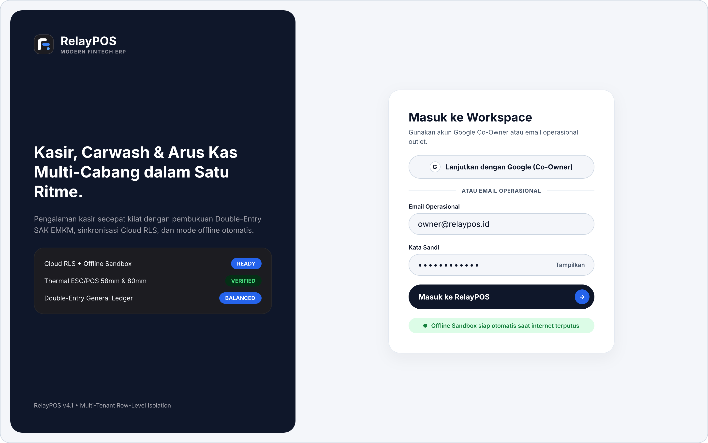

### 03 — Executive Cockpit Dashboard (Light Mode Cobalt)
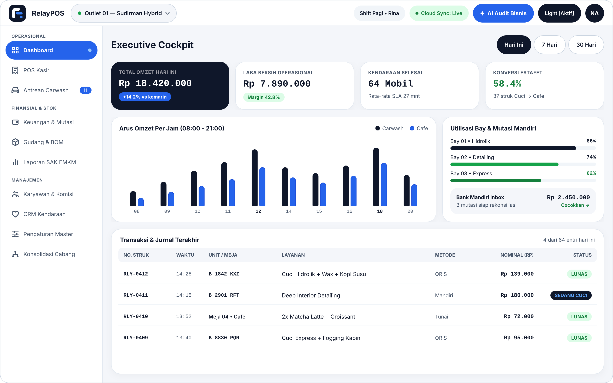

### 04A — Hybrid POS: Intake Kendaraan (`carwash` + CRM) & Pelunasan Tunai (`struk`)
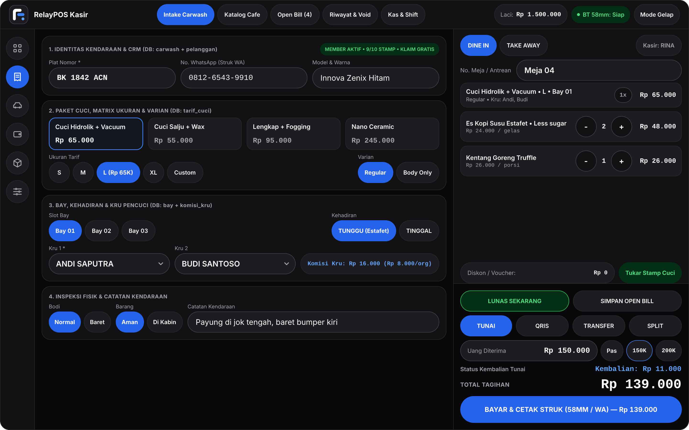

### 04B — Hybrid POS: Katalog Cafe & Merchandise, Catatan Item & `SPLIT` Payment


### 05 — Antrean Carwash & Live Kanban Bay Monitor


---

## Galeri Pratinjau Wave 2 — Back-Office ERP (`06`–`11`)

### 06 — Keuangan & Inbox Mutasi Email Bank Mandiri (`/finance`)
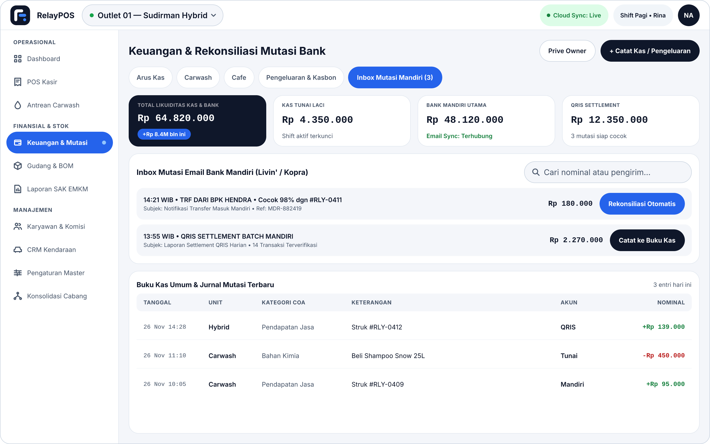

### 07 — Gudang, Inventori BOM & Stock Opname (`/gudang`)
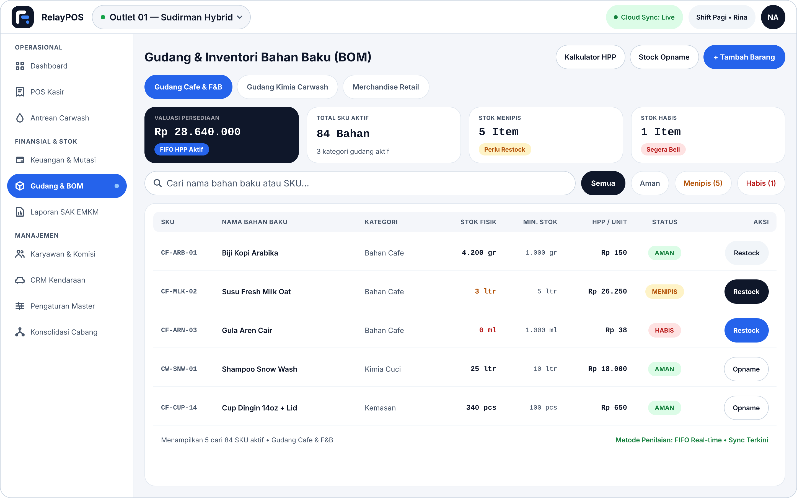

### 08 — Laporan Laba Rugi & Buku Besar SAK EMKM (`/reports`)
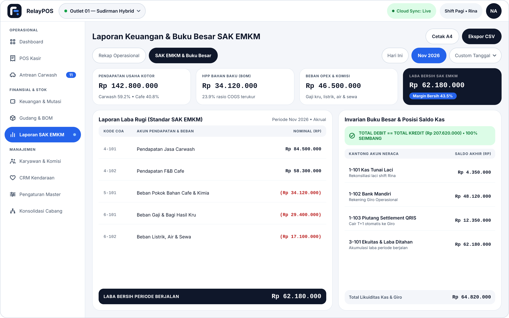

### 09 — Karyawan, Payroll Komisi Cut-Off & Undangan Co-Owner (`/karyawan`)
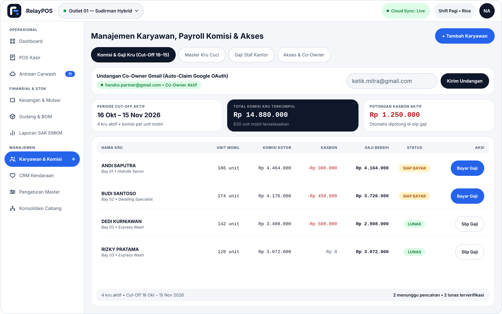

### 10 — CRM Kendaraan, Stamp Loyalty & Retensi WhatsApp (`/crm`)
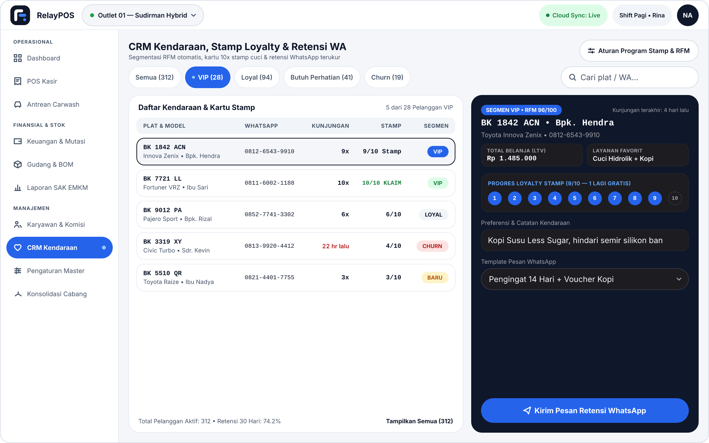

### 11 — Admin Master, Resep BOM Atomik & Live Preview Struk 58mm (`/admin`)
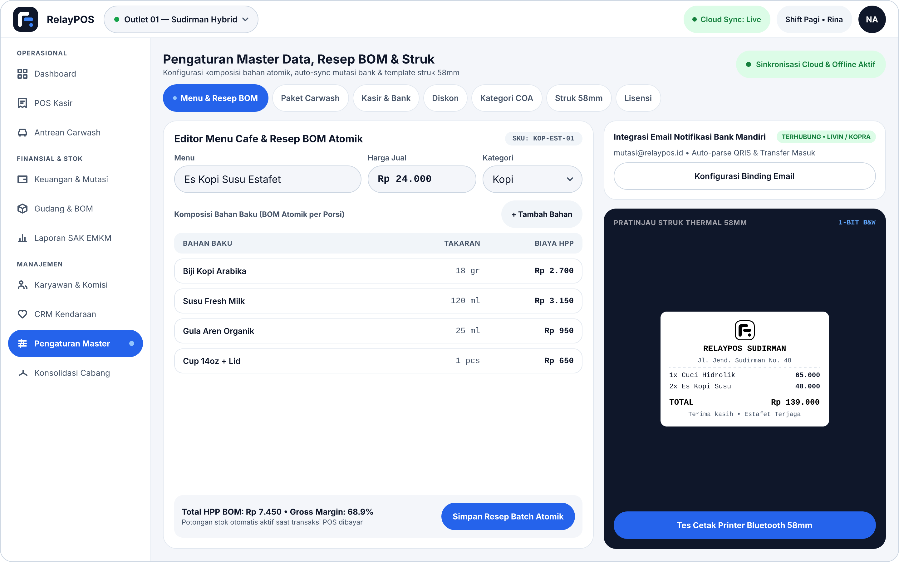

---

## Galeri Pratinjau Wave 3 — Multi-Cabang, Publik & Platform (`12`–`15`)

### 12 — Konsolidasi Multi-Outlet & Matriks Profitabilitas Cabang (`/konsolidasi`)
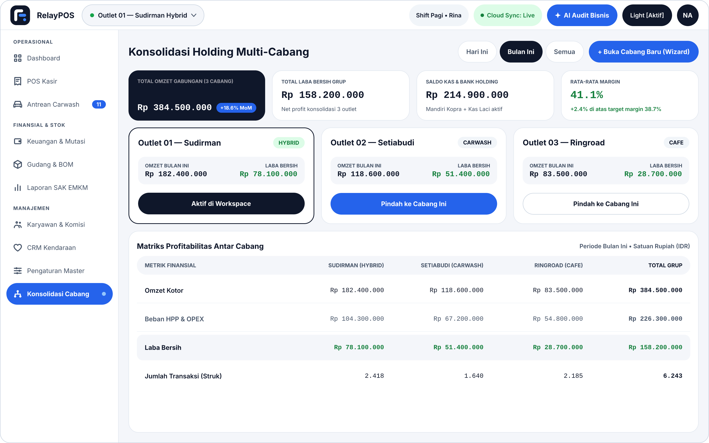

### 13 — Public SaaS Landing Page (`/welcome`)
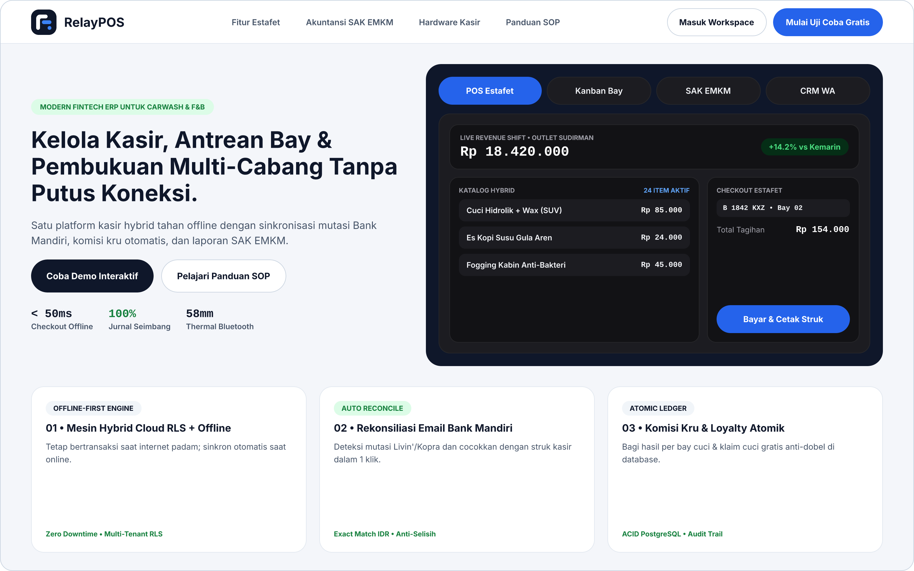

### 14 — Pusat Dokumentasi & SOP Operasional Interaktif (`/panduan`)
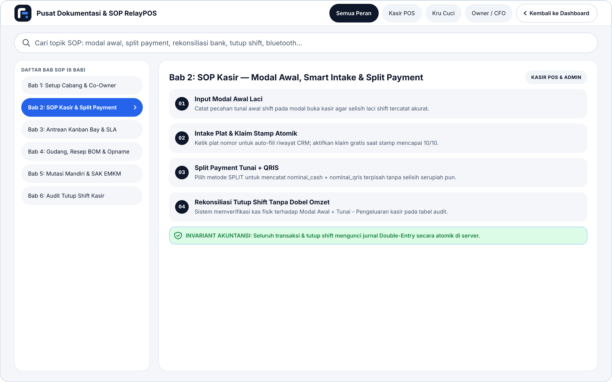

### 15 — Console Founder & SuperAdmin Platform (`/founder`)
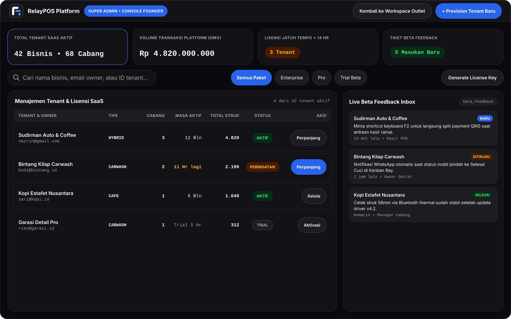

---

## Cara Membuka & Mengedit dari Perangkat Lain (Remote Access)

1. **Lihat langsung di GitHub:** Semua dokumentasi token, aset SVG, dan 17 pratinjau layar PNG 2x di atas langsung tampil di browser desktop maupun HP melalui halaman folder `design-system/` ini.
2. **Edit ulang di FigCraft Desktop:**
   ```bash
   git fetch origin
   git checkout chore/uiux-rebrand-plan
   git pull origin chore/uiux-rebrand-plan
   ```
   Lalu jalankan peluncur portabel Windows:
   ```cmd
   scripts\open-figcraft.cmd
   ```
   *(Skrip otomatis membuka `design-system\RelayPOS-Rebrand.figcraft` dengan port kontrol MCP `--control 7979` dan izin tulis folder repo).*
