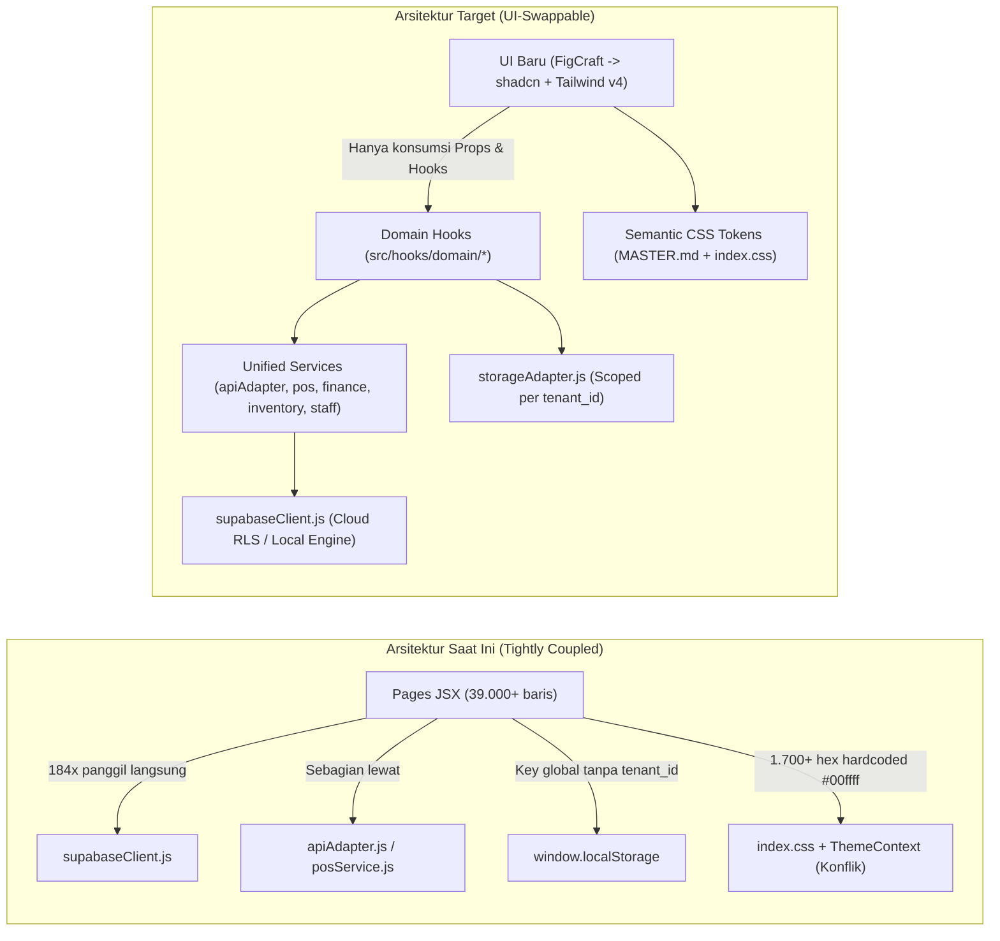

# Rencana Master Rebranding UI/UX & Isolasi Arsitektur Frontend — ERPPoss

## Deskripsi Tujuan

Melakukan **rebranding UI/UX menyeluruh** pada aplikasi **ERPPoss (RelayPOS SaaS ERP)**—mulai dari perancangan visual berbasis **FigCraft (via MCP)** hingga penggantian komponen antarmuka React—**tanpa memutus atau merusak satu pun koneksi ke backend** (Supabase Cloud PostgreSQL + RLS, Local Offline Sandbox Engine, Realtime WebSocket, maupun Web Bluetooth ESC/POS Thermal Printer).

Rencana ini disusun menggunakan empat pilar utama:
1. **`ponytail-review`** — Audit bedah arsitektur `src/` saat ini untuk memetakan di mana UI masih terikat langsung (*tightly coupled*) dengan query database, `localStorage`, dan hardware kasir.
2. **FigCraft MCP Design-First** — Alur pembuatan sistem token, komponen dasar, dan layar utama di kanvas FigCraft sebelum menyentuh kode JSX produksi.
3. **`ui-ux-pro-max` + `ui-styling` + `web-app-development`** — Standar sistem desain B2B Enterprise ERP padat data (*High-Density 8/10*), token CSS semantik 3-lapis (Tailwind CSS v4 + primitif setara Radix/shadcn), ergonomi layar sentuh kasir `>= 44px`, dan kepatuhan ketat **Anti-AI Slop** (tanpa neon sian menyilaukan `#00ffff`, tanpa gradien ungu/indigo murahan, wajib 4 *UI States* & `tabular-nums` untuk nominal Rupiah).
4. **Strangler-Fig UI Migration** — Strategi penggantian halaman bertahap di atas *Headless Domain Hooks* sehingga 100% pengujian Vitest dan transaksi akuntansi *Double-Entry* tetap hijau.

---

## Peringatan Penting Sebelum Eksekusi

> [!CAUTION]
> **Jangan Langsung Mengganti File JSX Halaman Sebelum Layer Decoupling Selesai (Fase 1):** Saat ini terdapat **184 pemanggilan langsung `supabase.*`** di dalam file halaman JSX. Jika kita langsung mengganti tampilan halaman seperti [`src/pages/pos/HybridPOSPage.jsx`](../src/pages/pos/HybridPOSPage.jsx) atau [`src/components/pos/ThermalReceiptModal.jsx`](../src/components/pos/ThermalReceiptModal.jsx) tanpa mengekstrak logika RPC Cloud vs Local (`isCloudBackend`), `localStorage` modal awal, dan CSS cetak struk thermal (`body.has-thermal-receipt`), maka fitur *Void Nota*, *Tutup Kasir*, *Multi-Tenant Switcher*, dan *Cetak Struk 58mm/80mm* akan rusak.

---

## Keputusan Desain yang Perlu Dikonfirmasi User (Open Questions)

Sebelum mengeksekusi Fase 2 (FigCraft MCP), agen lokal perlu mengonfirmasi 3 poin berikut dengan User:

1. **Identitas Brand Baru & Arah Visual (Rebranding):**
   - Apakah nama produk tetap **RelayPOS** atau berganti nama/logo baru?
   - Untuk tema warna utama (menggantikan hitam pekat `#000000` + sian neon `#00ffff` di [`src/index.css`](../src/index.css)):
     - **Opsi 1 (Dual-Mode Clean Enterprise — Direkomendasikan):** *Light Mode Default* untuk back-office/akuntansi (`#F8FAFC` Slate-50 canvas, `#FFFFFF` card, `#0F172A` Navy primary, `#0284C7` / `#0D9488` Teal/Emerald aksen fungsional) + *High-Contrast Dark Mode* opsional untuk area Kasir POS semi-outdoor/carwash.
     - **Opsi 2 (Refined Warm Charcoal Dark-First):** Tetap *Dark Mode*, namun mengganti `#000000` & `#00ffff` menjadi *Warm Graphite/Zinc* (`#09090B` / `#18181B`) dengan aksen *Crisp Emerald* atau *Executive Cobalt* yang nyaman di mata.
2. **Konfirmasi Stack Styling (`Tailwind CSS v4` + Primitif `shadcn/ui`):**
   - Mempertahankan `tailwindcss@^4.3.3` + `@tailwindcss/vite@^4.3.3` yang sudah ada di [`package.json`](../package.json), dikombinasikan dengan komponen aksesibel berbasis **Radix UI / shadcn/ui** (`@radix-ui/react-dialog`, `select`, `tabs`, `dropdown-menu`).
3. **Prioritas Urutan Layar di FigCraft:**
   - **Wave 1 (Core Revenue):** Design System Kit + App Shell (`Sidebar` & `TenantSwitcher`) + `Login` + `Dashboard` + `POS Kasir` + `Antrean Carwash`
   - **Wave 2 (Back-Office ERP):** `Finance` + `Gudang` + `Reports (SAK EMKM)` + `Karyawan` + `CRM` + `Admin`
   - **Wave 3 (Public & Platform):** `LandingPage` + `UserManualPage` + `Konsolidasi` + `Founder Console`

---

## Audit Arsitektur Frontend Saat Ini (`ponytail-review`)

### Peta Aliran Data Saat Ini vs Target Decoupled Architecture



### Laporan `ponytail-review`

**What this architecture does:**
Aplikasi ini adalah SPA React 19 + Vite 8 yang berjalan dalam dua mode database ([`src/supabaseClient.js`](../src/supabaseClient.js)): PostgreSQL Supabase Cloud (dengan RLS & RPC) dan mesin offline di memori/browser ([`src/services/localDbEngine.js`](../src/services/localDbEngine.js)). Saat ini logika koneksi backend terbagi dua: sebagian sudah rapi di `src/services/*`, tetapi sebagian besar masih tertanam langsung di dalam file tampilan `src/pages/*.jsx`. Beban yang diasumsikan: banyak kasir, kru cuci, admin, dan multi-outlet owner yang membuka aplikasi bersamaan di tablet kasir dan desktop.

#### Must fix (Wajib dibereskan agar ganti UI tidak memutus backend)

1. **184 query & RPC `supabase.*` dipanggil langsung dari file JSX halaman** (`src/pages/Admin.jsx:L302-332`, `src/pages/pos/HybridPOSPage.jsx:L1240-1265`, `src/pages/Finance.jsx:L725-886`)
   - **What this is:** Komponen halaman merakit sendiri query tabel dan percabangan `if (isCloudBackend)` di dalam fungsi klik tombol.
   - **Problem:** Di `HybridPOSPage.jsx:L1240-1265`, pembatalan struk (*Void*) menjalankan RPC `fn_void_or_cancel_receipt` saat Cloud, tetapi menjalankan 3 `UPDATE` manual (`struk`, `cafe`, `carwash`) saat Local. Jika komponen UI baru dibuat dari FigCraft dan lupa menyalin salah satu cabang ini, fitur *Void* atau *Tutup Shift* (`HybridPOSPage.jsx:L1392-1404`) langsung gagal di produksi.
   - **Fix:** Pindahkan seluruh query/RPC dari `src/pages/*` ke `posService.js`, `apiAdapter.js`, serta service domain tipis (`financeService.js`, `inventoryService.js`, `staffService.js`). Halaman UI dilarang mengimpor `supabaseClient` secara langsung.
   - **If we skip it:** Mengganti halaman UI akan merusak sinkronisasi stok, pembatalan nota, atau penutupan kasir antara mode Cloud dan Offline.

2. **Halaman Gudang dan Karyawan tidak me-reload data saat Owner pindah cabang & menampilkan stok palsu saat kosong** (`src/pages/Gudang.jsx:L158-171`, `src/pages/Karyawan.jsx:L234-285`)
   - **What this is:** Efek pemuatan data awal pada menu Gudang (`/gudang`) dan Karyawan (`/karyawan`) ketika Owner memakai dropdown `TenantSwitcher`.
   - **Problem:** `useEffect` di `Gudang.jsx:L169-171` dan `Karyawan.jsx:L234-236` memakai dependency kosong `[]` tanpa `activeTenant?.id`. Lebih berbahaya lagi, jika outlet baru memiliki 0 barang (`rawData.length === 0`), baris 159 mengisi state dengan `DEFAULT_GUDANG_DATA` (stok contoh palsu).
   - **Fix:** Masukkan `activeTenant?.id` ke dependency hook data, tambahkan `.eq('tenant_id', activeTenant.id)`, dan tampilkan *Empty State* asli saat tabel kosong.
   - **If we skip it:** Owner yang memiliki 2 cabang akan melihat stok dan daftar gaji cabang lama setelah mengganti outlet aktif, atau mengira cabang baru sudah punya stok barang.

3. **Penyimpanan resep paket cuci di `Admin.jsx` menghapus lalu meng-insert satu per satu tanpa transaksi** (`src/pages/Admin.jsx:L577-620`)
   - **What this is:** Handler simpan paket cuci yang memperbarui komposisi bahan kimia (BOM) di tabel `resep`.
   - **Problem:** Kode menghapus seluruh `resep` lama lebih dulu (`L578`), lalu melakukan `await supabase.from('resep').insert(...)` di dalam `for` loop (`L596-619`) dari browser. Jika sinyal internet terputus di tengah loop, resep lama sudah terhapus dan resep baru hanya masuk separuh.
   - **Fix:** Kumpulkan seluruh baris resep ke satu array lalu kirim sekaligus dalam satu *batch insert* (atau RPC atomik) di dalam `api.master`.
   - **If we skip it:** Koneksi lambat saat edit menu/paket membuat pemotongan HPP & stok otomatis kasir meleset tanpa pesan error yang jelas.

4. **Kategori kustom Keuangan & Modal Awal Kasir tersimpan di `localStorage` tanpa standar isolasi** (`src/pages/Finance.jsx:L216-274`, `src/pages/pos/HybridPOSPage.jsx:L1343-1385`)
   - **What this is:** Penyimpanan opsi kategori pengeluaran/pemasukan tambahan dan status input modal laci kasir pagi hari.
   - **Problem:** `Finance.jsx` menyimpan kategori di key global `jb_custom_jenis_list` tanpa `tenant_id` (bocor antar-outlet di browser yang sama). Selain itu, jika UI `Finance` baru hanya membaca tabel `master_categories` dari DB, semua kategori kustom milik user hilang.
   - **Fix:** Bungkus seluruh akses `localStorage` ke dalam satu `src/services/storageAdapter.js` dengan prefix `tenant_id`, dan migrasikan kategori kustom ke `master_categories`.
   - **If we skip it:** Saat UI baru dipasang, kasir bisa diminta mengisi modal awal berulang kali atau kehilangan kategori kas yang biasa dipakai.

#### Should fix (Penghambat skalabilitas & penyebab UI sulit di-rebrand)

5. **Dua sistem tema yang saling bertabrakan + 1.700+ warna hex hardcoded** (`src/context/ThemeContext.jsx:L78-84`, `src/index.css:L4-101`, `src/components/ui/Button.jsx:L20-25`)
   - **What this is:** Pengaturan warna dan tema visual aplikasi.
   - **Problem:** `ThemeContext.jsx` menulis `--brand-primary` ke `:root`, namun hanya dipakai oleh `Login.jsx` (dan tema #4 memakai ungu neon `#6366f1`/`#c084fc` yang melanggar aturan Anti-AI Slop). Sementara komponen lain menulis hex mentah `bg-[#00ffff]`, `bg-[#121215]`, `border-[#26272d]` lebih dari 1.700 kali (`Admin.jsx` 241x, `Finance.jsx` 211x, `Dashboard.jsx` 204x).
   - **Fix:** Satukan ke sistem token CSS variabel 3-lapis di `index.css` (`bg-canvas`, `bg-surface`, `text-foreground`, `bg-primary`), perbarui `ThemeContext.jsx` agar mengganti atribut `data-theme` / class `.dark`, dan hapus preset ungu neon.
   - **If we skip it:** Mengubah palet rebranding di `index.css` tidak akan mengubah warna 80% komponen karena tertimpa class hex arbitrer.

6. **Empat "God-Pages" berukuran 2.100–5.240 baris mencampur state database, kalkulasi akuntansi, dan layout** (`HybridPOSPage.jsx` 5.241 baris, `Finance.jsx` 4.225 baris, `Admin.jsx` 3.922 baris, `Dashboard.jsx` 2.189 baris)
   - **What this is:** Struktur komponen halaman utama ERP.
   - **Problem:** Satu file `HybridPOSPage.jsx` memegang >40 `useState`, keranjang gabungan, komisi kru, opname stok, hingga riwayat struk. Mengganti 5.241 baris sekaligus hampir pasti menimbulkan regresi.
   - **Fix:** Pisahkan berdasarkan tugas (*split by job*): satu *headless controller hook* (`usePosWorkspace`) untuk state & aksi bisnis, dan sub-komponen presentasi murni (`PosCatalog`, `PosCartPanel`, `PosPendingTab`, `PosHistoryTab`).
   - **If we skip it:** Proses rebranding menjadi lambat, rawan konflik, dan sulit diuji per bagian.

7. **Channel Realtime `CarwashQueue` mendengar seluruh tenant tanpa filter dan tanpa debounce** (`src/pages/CarwashQueue.jsx:L138-148`)
   - **What this is:** Langganan WebSocket Supabase untuk memperbarui papan antrean cuci mobil secara langsung.
   - **Problem:** `.on('postgres_changes', { event: '*', schema: 'public', table: 'carwash' }, () => fetchQueue())` tidak menyertakan `filter: tenant_id=eq.<id>` maupun jeda *debounce*. Saat banyak cabang aktif bersamaan, setiap perubahan baris memicu query ulang penuh.
   - **Fix:** Pindahkan ke hook `useCarwashQueue(tenantId, selectedDate)` dengan `filter: \`tenant_id=eq.${tenantId}\`` dan debounce 250ms.
   - **If we skip it:** Beban query meningkat tajam seiring bertambahnya jumlah tenant aktif di produksi.

#### Nice to have (Pengaman kontrak hardware & penyusutan baris kode)

8. **Kontrak CSS & Portal khusus Cetak Struk Thermal tercampur di `index.css` utama** (`src/index.css:L351-405`, `src/components/pos/ThermalReceiptModal.jsx:L46-48`)
   - **What this is:** Mekanisme penyembunyian `#root` (`body.has-thermal-receipt #root { display: none !important }`) saat mencetak struk 58mm/80mm melalui `createPortal`.
   - **Problem:** Aturan `@media print` ini berada di bagian bawah `index.css`. Jika `index.css` ditulis ulang saat rebranding dan class ini tidak sengaja terhapus, bug halaman ke-2 kosong dan tercetaknya sidebar pada kertas struk akan kambuh.
   - **Fix:** Ekstrak seluruh aturan `@media print` thermal dan A4 ke file terisolasi `src/styles/print-contracts.css` yang di-import permanen dan tidak boleh diubah oleh proses styling UI.
   - **If we skip it:** Rebranding CSS berisiko merusak cetakan printer kasir fisik di lapangan.

- **Verdict:** `Fix 1, 2, 3, 4, and 8 first` sebagai fondasi *Backend Shield* (Fase 1), lalu jalankan rebranding visual FigCraft -> React secara aman (Fase 2–4).
- **Lean:** Potensi pengurangan **~6.500+ baris kode duplikat** di `src/pages/*` dengan menyatukan pola tabel, modal, filter tanggal, dan query service.

---

## Rincian Fase Implementasi

### Fase 1: Backend Connection Shield (Headless Domain & Service Facade)
- **[NEW] `src/services/storageAdapter.js`** — Helper terpusat untuk seluruh state `localStorage` dengan prefix `tenant_id`.
- **[MODIFY] `src/services/apiAdapter.js` & `src/services/posService.js`** — Memindahkan percabangan Cloud RPC vs Local DB dari `HybridPOSPage.jsx` (`voidTransaction`, `closeCashierShift`, `recordMoneyExchange`, `getPendingBills`) dan memperbaiki *batch insert* resep di `api.master`.
- **[NEW] `src/services/financeService.js`, `src/services/inventoryService.js`, `src/services/staffService.js`** — Mengekstrak query/mutasi tabel keluar dari halaman JSX.
- **[NEW] `src/hooks/domain/*`** (`usePosWorkspace.js`, `useCarwashQueue.js`, `useWarehouseInventory.js`, `useFinanceLedger.js`, `useExecutiveDashboard.js`, `useStaffDirectory.js`) — Hook *headless* reaktif terhadap `activeTenant?.id` yang mengekspor 4 state standar (`isLoading`, `error`, `isEmpty`, `data`) + `actions.*`.
- **[NEW] `src/styles/print-contracts.css`** — Mengunci aturan cetak struk thermal 58mm/80mm & A4 agar terisolasi dari perubahan CSS tema.

### Fase 2: Sistem Desain Rebranding & Eksplorasi Kanvas di FigCraft (via MCP)
- **[NEW] `design-system/MASTER.md` & `design-system/pages/*.md`** — Berdasarkan `ui-ux-pro-max` (`--density 8 --motion 4 --variance 5`), `ui-styling`, dan `web-app-development`:
  - Tipografi: `Plus Jakarta Sans` + `JetBrains Mono` (`tabular-nums` untuk seluruh nominal uang).
  - Spasi & Ergonomi: Ritme 4/8dp, target sentuh kasir minimum `44x44px`, efek tekan `active:scale-[0.98]`.
  - Anti-AI Slop: Nol `#00ffff` neon, nol gradien ungu/indigo, nol emoji sebagai ikon struktural (100% ikon SVG `lucide-react` stroke `1.75px`).
- **Pembuatan Frame di FigCraft via MCP:**
  - *Frame 00:* Brand & Token Sheet (Light/Dark, Typography, Surfaces, Badges)
  - *Frame 01:* Core UI Kit (`Button`, `Input`, `Select`, `Dialog/Drawer`, `Tabs`, `DataTable` 4-state, `StatCard`, `Sidebar + TenantSwitcher`)
  - *Frame 02–04 (Wave 1):* `Login`, `Dashboard`, `POS Kasir` (Desktop & Tablet), `Carwash Queue`
  - *Frame 05–08 (Wave 2 & 3):* `Finance`, `Gudang`, `Reports`, `Karyawan`, `CRM`, `Admin`, `Konsolidasi`, `LandingPage`

### Fase 3: Fondasi UI Primitif & App Shell Baru di Kode (`ui-styling`)
- **[MODIFY] `package.json`** — Menambahkan primitif Radix UI seperlunya (`dialog`, `select`, `tabs`, `dropdown-menu`, `clsx`, `tailwind-merge`).
- **[MODIFY] `src/index.css` & `src/context/ThemeContext.jsx`** — Sistem CSS variabel semantik 3-lapis + penyatuan `ThemeContext`.
- **[MODIFY] `src/components/ui/*` & `src/components/Sidebar.jsx` & `src/components/TenantSwitcher.jsx`** — Implementasi UI Kit dan App Shell baru sesuai hasil FigCraft dengan menjaga `ProtectedRoute` dan RBAC di `src/App.jsx` tetap utuh.

### Fase 4: Migrasi Halaman Bertahap (*Strangler-Fig Rollout*)
- Mengganti halaman per gelombang (*Wave 1 -> Wave 2 -> Wave 3*) dengan memecah *God-Pages* menjadi sub-komponen presentasi murni di atas *Domain Hooks* Fase 1.

---

## Rencana Verifikasi

```bash
# 1. Seluruh unit & integration test (termasuk multi-tenant & GL double-entry) wajib 100% lulus
npm run test

# 2. Linter, pengecekan variabel AST, dan build produksi
npm run lint
node scripts/verifyNoUndeclaredVars.js
npm run build

# 3. Verifikasi nol hex legacy tersisa setelah Fase 4 selesai
rg "#00ffff|#121215|#18181c" src/pages src/components
```
